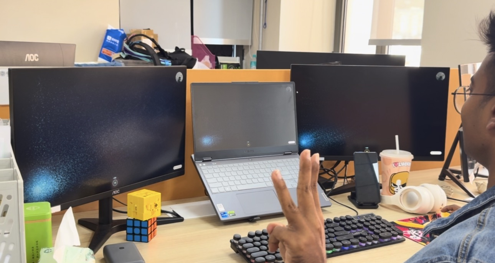
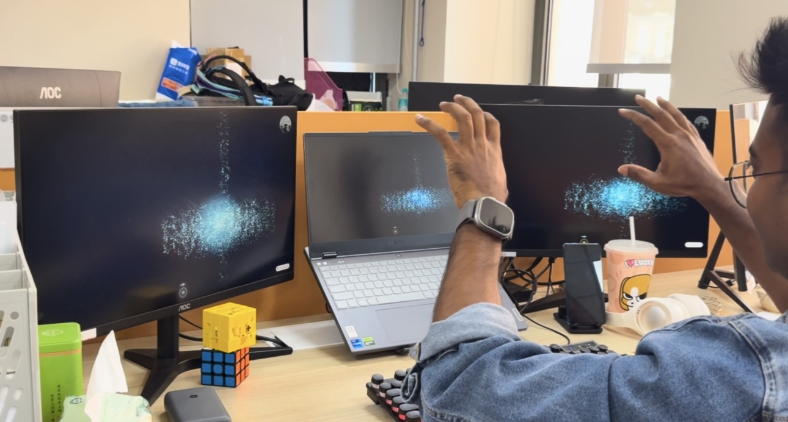
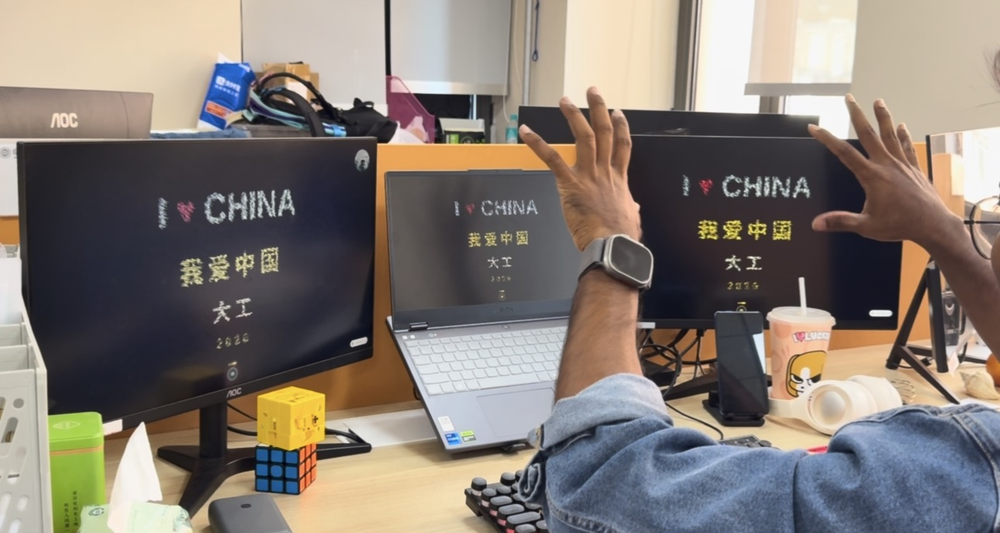

# China Gesture Celebration

An interactive browser experience that turns live hand gestures into a particle-based celebration of China and Dalian University of Technology (DUT / 大工).

## Project preview

### 1. Activate with a Victory gesture



### 2. Guide the particle formation



### 3. Reveal the final message



## Use

1. Select the camera button and allow access.
2. Show a Victory sign to start the particle formation.
3. Pinch your thumb and index finger to reveal the final message.

The application processes camera frames in the browser. Its application code does not upload or store camera images.

## Run locally

Requires Node.js 22.13 or newer.

```bash
npm install
npm run dev
```

For a production build:

```bash
npm run build
npm run start
```

Set `NEXT_PUBLIC_SITE_URL` to the deployed HTTPS address when building for production. Camera access normally requires HTTPS or `localhost`.

## Contact

- siyamurrahaman@mail.dlut.edu.cn
- siyamurrahaman1@hotmail.com

## License

The project code uses the MIT License. Bundled Google MediaPipe components use the Apache License 2.0. Both are included in [LICENSE](LICENSE).
